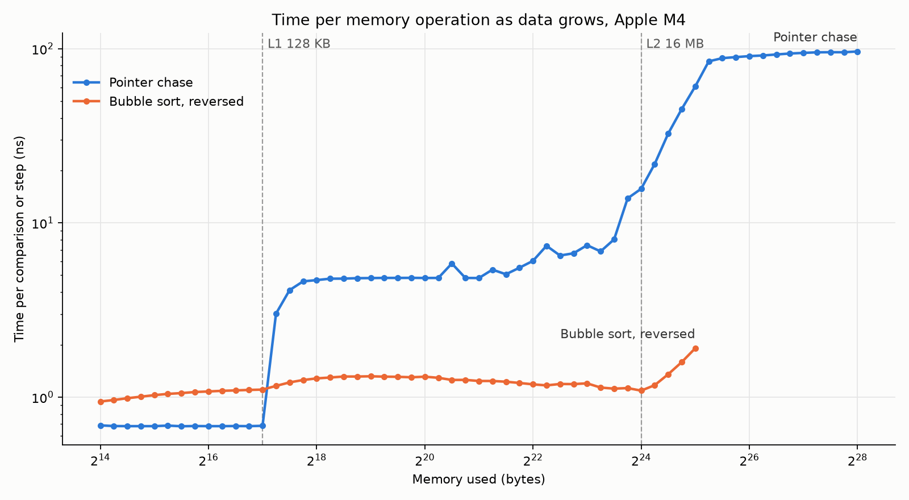

# cache-timing

Measures how memory access time changes as the working set grows, to find the cache sizes of an Apple M4. Each data point times a loop over a buffer of a given size; when the buffer stops fitting in a cache level, the time per operation jumps.



## Estimated cache sizes (Apple M4, P-core)

Read from `chase.csv` (random pointer chase, one load per step):

| Level | Estimated size | Latency per load | Evidence |
|-------|----------------|------------------|----------|
| L1 data | **128 KB** | ~0.68 ns | Flat at 0.68 ns up to 131,072 B, jumps to 3.0 ns at 155,776 B |
| L2 | **~12–16 MB** | ~4.8 ns | Flat at ~4.8 ns to ~2 MB, slow rise to ~8 ns by 11.9 MB, then sharp climb from 14 MB |
| Main memory | — | ~90–96 ns | Levels off from ~40 MB onward |

Notes:

- The slow rise in the L2 region from ~2.5 MB to ~12 MB is most likely TLB misses (more pages touched than the TLB covers), not a separate cache level.
- No distinct step for the system level cache shows up between L2 and DRAM; the 16–40 MB range is a smooth climb.
- These numbers match Apple's published M4 P-core figures (128 KB L1D, 16 MB shared L2).

## How it works

`cache.c` has three tests. Every element is padded to 128 bytes (`LINE`), the M-series cache line size, so each element sits on its own line.

- **`chase`** – Links every line in the buffer into one random cycle (Sattolo's algorithm) and follows the pointers for 20M steps. Each load depends on the previous one and the order is random, so the prefetcher can't help. This gives raw load latency and is the test used for the size estimates. Sizes go up to 256 MB.
- **`reversed`** – Bubble sorts a reverse-ordered array and reports time per comparison. Access is sequential, so the prefetcher hides most of the latency: the curve only rises slightly past L1 and climbs again past ~20 MB. Sizes go up to 32 MB.
- **`random`** – Same bubble sort on random keys.

Sizes step by a factor of 2^(1/4) starting at 16 KB. Each size is run several times and the fastest run is kept. The thread is set to `QOS_CLASS_USER_INTERACTIVE` so it is scheduled on a P-core.

macOS only (`clock_gettime_nsec_np`, `arc4random_uniform`, `pthread_set_qos_class_self_np`).

## Build and run

```sh
cc -O2 -o cache cache.c
./cache chase    > chase.csv
./cache reversed > reversed.csv
./cache random   > random.csv
```

## Plot

Requires matplotlib.

```sh
python3 -m venv venv && source venv/bin/activate
pip install matplotlib
python3 plot.py chase.csv reversed.csv
```

This writes `cache_plot.png`. Pass any combination of the CSV files.

## Files

| File | Contents |
|------|----------|
| `cache.c` | Benchmark |
| `plot.py` | Plots CSV results to `cache_plot.png` |
| `chase.csv` | Pointer chase results, 16 KB – 256 MB |
| `reversed.csv` | Reversed bubble sort results, 16 KB – 32 MB |
| `cache_plot.png` | Plot of the two result files |
